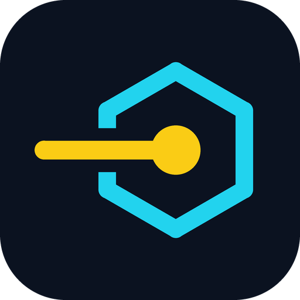

<p align="center"></p>

# Contributing to sne

Thank you for wanting to help. sne is a small project, so every bug report, platform fix and
documentation correction makes a visible difference.

This guide covers how to report a problem, how to set up the code, and what a pull request needs
before it can be merged.

## Ways to help

| You want to | Do this |
|---|---|
| Report a bug | Open a [bug report](https://github.com/sne-sh/sne/issues/new?template=bug_report.yml). Include the output of `sne doctor`. |
| Suggest a feature | Open a [feature request](https://github.com/sne-sh/sne/issues/new?template=feature_request.yml) before writing code, so we can agree on the design first. |
| Ask a question | Use [Discussions](https://github.com/sne-sh/sne/discussions), not an issue. |
| Report a security problem | Do not open a public issue. Follow [SECURITY.md](SECURITY.md). |
| Fix the docs | Edit the files in `docs/` and open a pull request. No issue needed. |
| Fix a bug or build a feature | Read the rest of this page. |

Good first contributions: testing sne on a system or shell we have not covered, improving an error
message that confused you, and adding a missing case to the tests.

## Set up

You need a recent stable [Rust toolchain](https://rustup.rs) and Git. Nothing else.

```sh
git clone https://github.com/sne-sh/sne
cd sne
cargo build
cargo test
```

`cargo test` runs the unit tests and the end-to-end tests in `tests/e2e.rs`. The end-to-end tests
start a fake local mirror, so they need no internet access and install nothing outside `target/`.

### Try your build without touching your own setup

Point sne at a throwaway data folder:

```sh
SNE_DIR=/tmp/sne-dev cargo run -- install lts
SNE_DIR=/tmp/sne-dev cargo run -- ls
```

In PowerShell:

```powershell
$env:SNE_DIR = "$env:TEMP\sne-dev"
cargo run -- install lts
```

## Before you open a pull request

Run the same three checks that CI runs:

```sh
cargo fmt
cargo clippy --all-targets -- -D warnings
cargo test
```

CI runs them on Windows, Linux (x64 and ARM64) and macOS, then installs real Node.js versions with the
built program. A pull request needs all of it green.

## Ground rules

- **The hot path stays fast.** `sne use`, `sne use --auto` and `sne env` run in every terminal and on
  every `cd`. They must not use the network or parse the release list. If you change them, run
  `benches/bench.sh` before and after and put both results in the pull request.
- **All three systems matter.** Code behind `#[cfg(windows)]` needs its `#[cfg(not(windows))]`
  counterpart. If you can only test on one system, say so in the pull request; CI and reviewers cover
  the rest.
- **Keep dependencies few.** Each one adds to startup time, binary size and build time. Explain why a
  new dependency is needed.
- **Nothing is half-installed.** Anything that writes a version or replaces a file does it in a
  temporary place and renames it into position at the end.
- **Verify what is downloaded.** Every download is checked against a published SHA-256 before it is
  used.
- **Error messages say what to do next.** "Node `22` is not installed. Run `sne install 22`" is the
  standard to aim for.

## Layout

| Path | Contents |
|---|---|
| `src/main.rs` | Command-line definition |
| `src/commands/` | One module per group of commands (`install`, `switch`, `list`, `env`, `update`) |
| `src/resolve.rs` | Turning `22`, `lts` and ranges into an exact version |
| `src/index.rs` | The Node.js release list and its cache |
| `src/download.rs`, `src/extract.rs` | Streaming download, checksum, unpacking |
| `src/link.rs` | Symlinks and junctions |
| `src/shell.rs` | Setup code for each shell |
| `src/version_file.rs` | `.nvmrc`, `.node-version`, `package.json` |
| `tests/e2e.rs` | End-to-end tests against a fake mirror |
| `install.ps1`, `install.sh` | One-line installers |
| `installer/` | Windows setup wizard (Inno Setup) |
| `packaging/` | Linux package definition (nfpm), AUR and winget files, `update-manifests.ps1` |
| `npm/` | The npm launcher package and the script that builds the per-system packages |
| `bucket/`, `Formula/` | Scoop manifest and Homebrew formula; this repository is the bucket and the tap |
| `docs/` | User documentation, published with GitBook |
| `site/` | Project website, published with GitHub Pages |
| `.github/workflows/` | CI, release, benchmark and website workflows |

## Tests

- Put unit tests next to the code, in a `tests` module at the bottom of the file.
- Put anything that runs the real program in `tests/e2e.rs`. Use the fake mirror there; tests must not
  reach the internet.
- A bug fix comes with a test that fails without the fix.

## Documentation

User-facing changes need a matching change in:

- `docs/`, where each command and option is described;
- `README.md`, if the change affects installing or the basic commands;
- `CHANGELOG.md`, one line under the newest heading.

Write in short, plain sentences. Many readers are not native English speakers.

## Commits and pull requests

1. Fork the repository and create a branch from `develop`.
2. Keep each pull request to one change. Two small pull requests are reviewed faster than one large one.
3. Write commit messages that say what changed and why, in the imperative: "Fix the link target on
   Git Bash", not "fixed stuff".
4. Fill in the pull request template. It asks what you tested and on which systems.
5. Open the pull request against `develop`, not `main`.
6. A maintainer reviews it. Expect questions; they are about the code, not about you.

### Branches

| Branch | Purpose | Who can push |
|---|---|---|
| `develop` | Where all work lands first. Pull requests target it. | Maintainers only; everyone else through a pull request |
| `main` | What is released. The install scripts and the website are served from it. | Maintainers only |

Both branches are protected. A pull request needs green checks and a maintainer's approval before
it is merged.

## Releases

Maintainers make releases. For reference, the steps are:

1. Set the version in `Cargo.toml` and add a heading for it in `CHANGELOG.md`.
2. Push a tag equal to that version, without a `v`: `0.2.0` or `0.2.0-beta.1`.
3. The Release workflow runs every check, builds the installers for every system and creates a draft
   release.
4. Review the draft on GitHub and publish it.
5. From the tagged commit, run `cargo publish --dry-run`, then `cargo publish`, to put the version on
   crates.io. A published version cannot be changed.
6. Run `pwsh packaging/update-manifests.ps1 <version>` and commit the result. It rewrites the Scoop
   manifest (`bucket/`), the Homebrew formula (`Formula/`), and the AUR and winget files in
   `packaging/` with the new version and checksums. The Packages workflow then installs sne with each.
7. Run `node npm/build.mjs <version> --publish` to build the npm packages from the release and publish
   them: the launcher `sne-cli` and one package per system. It needs `npm login` first.
8. Copy `packaging/aur/PKGBUILD` and `.SRCINFO` to the AUR repository of `sne-bin` and push it. Send
   the folder under `packaging/winget/manifests/` as a pull request to `microsoft/winget-pkgs`.

To test the release build without releasing, push to the `release-dry-run` branch.

## Conduct

Everyone taking part is expected to follow the [Code of Conduct](CODE_OF_CONDUCT.md).

## License

sne is released under the [MIT license](LICENSE). By contributing, you agree that your contribution
is released under the same license.
